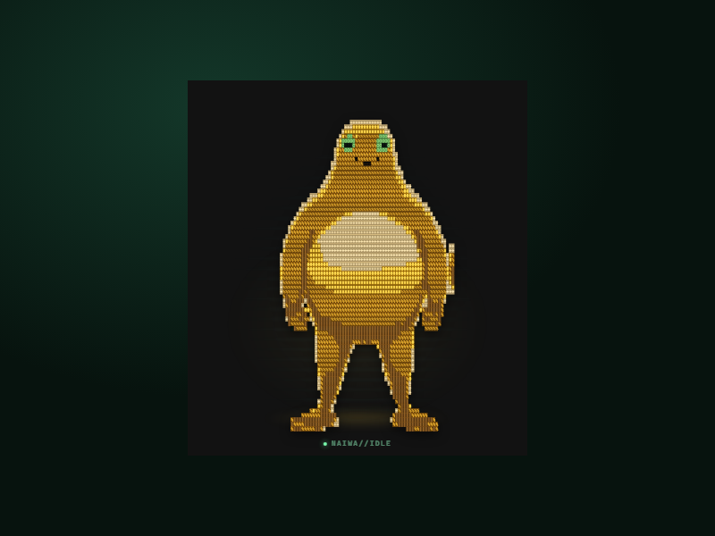
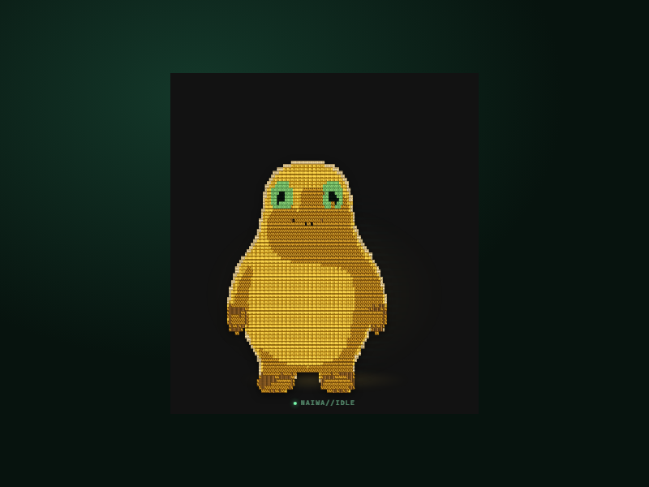
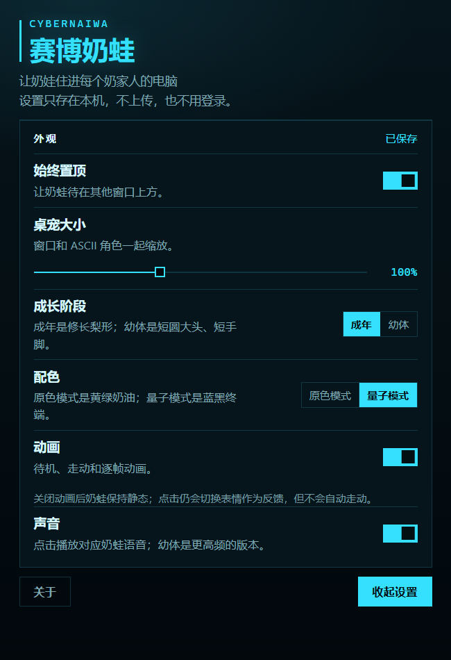

# Cyber Naiwa

> 赛博奶蛙 · A milk frog for your desktop.

[](https://github.com/natricknye/CyberNaiw/actions/workflows/build.yml)

[简体中文](README.md) | **English**

Cyber Naiwa (赛博奶蛙) is a cross-platform desktop pet built around 奶蛙 (Naiwa), the gleefully unhinged yellow frog from Chinese internet memes. The character isn't a flat image: it's a **pixel-mapped ASCII sprite of up to 128×80** (128×80 in Quantum mode, 112×70 in Original mode). The adult is tall and long-limbed; the baby is short, round, big-headed, with tiny limbs. Click it to trigger the laugh. Everything runs locally — no account, no cloud, no telemetry.

- A transparent, frameless, always-on-top pet window
- Left-drag to move, click to interact, right-click for a native menu
- Click to play Naiwa's laugh, with a mute switch in Settings
- Six states: Idle / Walk / Happy / Click / Wave / Sad
- Adult and baby Naiwa, in Quantum blue-black or warm Original colours
- Chinese app UI; English documentation in `README.en.md`
- Tray menu to show, hide, open settings, or quit
- Local JSON settings that survive a restart
- Fully offline; no database or sign-up
- Windows and macOS builds via GitHub Actions

## Download

| Platform | Installer | Notes |
| --- | --- | --- |
| Windows 10/11 x64 | [CyberNaiwa_0.2.0_x64-setup.exe](https://github.com/natricknye/CyberNaiw/releases/download/v0.2.0/CyberNaiwa_0.2.0_x64-setup.exe) | NSIS, installs for the current user; no admin required |
| macOS 11+ Apple Silicon | [CyberNaiwa_0.2.0_aarch64.dmg](https://github.com/natricknye/CyberNaiw/releases/download/v0.2.0/CyberNaiwa_0.2.0_aarch64.dmg) | Unsigned and not notarized; right-click → Open the first time |

[All releases](https://github.com/natricknye/CyberNaiw/releases) · [Build logs](https://github.com/natricknye/CyberNaiw/actions)

> The current macOS build is **arm64 only**. Intel Mac support is still on the list. Neither build is code-signed yet: Windows SmartScreen may warn, and macOS needs the right-click → Open dance on first launch.

## Preview

| Quantum mode · 128×80 | Original mode · 112×70 |
| --- | --- |
|  |  |

The pet is a coloured ASCII grid: 128×80 for Quantum mode, 112×70 for Original mode. `#` for the yellow body, `O` for the green eyes, `@` for the pupils, `+` for the cream belly, `|` for the olive-brown limbs, `_` for the mouth cavity, and `=` for the teeth. Closed-mouth frames keep the official reference's very short mouth line; no synthetic nose or hard chin line is drawn. Every cell has a matching solid backing so the character never lets the desktop show through, while everything outside the silhouette stays transparent. A soft CRT scanline pass sits on top, and the settings panel scales the whole sprite.

| Mode | Options |
| --- | --- |
| Growth stage | Adult (tall pear) / Baby (short, round, big-headed, tiny limbs) |
| Palette | Quantum mode (blue-black + cyan terminal, 128×80) / Original mode (warm yellow + cream + olive, 112×70) |
| Actions | Idle, walk, happy, click-to-interact (adult laugh / baby hands-on-hips), wave, downcast |

Baby preview:



> Quantum mode is the default. To see the normal/original form: open Settings → Palette → Original mode. The right-hand image above is the original colourway.

## Settings



Always-on-top, size, adult/baby, Original/Quantum mode, animation, sound, and restore defaults live in one panel.

## Stack

| Layer | Tech |
| --- | --- |
| Desktop shell | Tauri 2 |
| Frontend | React 19 + TypeScript + Vite |
| Looks | CSS + 128×80/112×70 ASCII frames + SVG icon |
| Native bits | Rust (tray, window lifecycle, quit) |
| Settings | `tauri-plugin-store`, local JSON |
| Package manager | pnpm (Corepack works too) |
| CI | GitHub Actions (Windows + macOS) |

## Requirements

- Node.js 22 LTS or newer
- pnpm 10+ (the repo pins a version through `packageManager`)
- Rust stable via `rustup`
- Windows: Visual Studio 2022 C++ tools + Windows 10/11 SDK + WebView2 Runtime
- macOS: Xcode Command Line Tools (`xcode-select --install`)

If pnpm isn't installed yet, Corepack can help:

```bash
corepack enable
corepack pnpm install
```

## Development

```bash
pnpm install
pnpm tauri dev
```

Just want the browser preview? Tauri APIs are skipped there:

```bash
pnpm dev
# Pet:     http://localhost:1420/?window=pet
# Settings: http://localhost:1420/?window=settings
```

## Build

```bash
# Everything configured in tauri.conf.json
pnpm tauri build

# Windows NSIS installer only
pnpm tauri build --bundles nsis

# macOS DMG only
pnpm tauri build --bundles dmg
```

Outputs:

- Windows: `src-tauri/target/release/bundle/nsis/*.exe`
- macOS: `src-tauri/target/release/bundle/dmg/*.dmg`

## Where settings live

The official `tauri-plugin-store` writes `settings.json` to the app data directory:

- Windows: `%APPDATA%\com.cybernaiwa.desktop\settings.json`
- macOS: `~/Library/Application Support/com.cybernaiwa.desktop/settings.json`

Two keys live in that file: `settings` (always-on-top, scale, animation, sound, adult/baby, Original/Quantum mode) and `windowPosition` (physical pixels). Nothing is synced anywhere.

## Character art

The default `cyber-naiwa` skin stores Original-mode adult/baby frames in `naiwa-frames.json` and `naiwa-baby-frames.json` (112×70), and Quantum-mode adult/baby frames in `naiwa-cyber-frames.json` and `naiwa-cyber-baby-frames.json` (128×80). Each set has six states and two frames per state. `frames.ts` maps characters to colour tones and declares frame timing. The grids were pixel-mapped from the official design database's adult, juvenile, laugh, wave, and downcast references; no reference image files themselves are shipped in the repo.

Want to try a PNG/WEBP/GIF skin? `src/assets/pets/README.md` shows how to register an `ImagePetSkin`. The renderer already handles both ASCII and image sequences. Please only add art you have the right to redistribute.

## Platforms and rough edges

- **Windows**: built and exercised on this machine. Transparency, the frameless window, native drag, tray, and settings persistence all work.
- **macOS**: transparent windows rely on `macOSPrivateApi`, which rules out the Mac App Store. The app hasn't been run on a Mac here; CI only proves it builds. Code signing and notarization are not configured yet.
- The whole pet window accepts mouse input; transparent margins don't click through yet. That's a known v1 limitation.
- Closing the settings window only hides it. Use the tray menu or Naiwa's right-click menu to quit.
- A click both gives feedback and starts the native drag, so a drag shows the "gotcha" face.
- With animation off, Naiwa stays still; clicks still change the expression, but there's no automatic walking.

## Design notes

The character follows the official Naiwa design database and the [Naiwa wiki](https://neta.art/app/milk-frog-wiki): the adult is tall and long-limbed, the baby is short, round, big-headed, with tiny limbs; both have a pale cream belly, pale green eye rings with centred black pupils, and a tiny horizontal mouth. Click-to-interact is the core interaction, with waving and looking down as extra actions. The [Nailong-Studio/NaiWa-Wallpaper](https://github.com/Nailong-Studio/NaiWa-Wallpaper) public asset index was also used for character poses and audio; artwork-integrated images were deliberately ignored.

## Voice and audio sources

The click bubbles “安迪 / 嘎嘎滴辣虾 / 卡脚先 / 无了 / 甘巴爹 / 有用不 / 哈哈哈哈哈” are Naiwa meme sound words from the Chinese internet, not lines written for this project:

- 《捧腹大笑思想与奶龙学概论》 chapter 6, “奶蛙的衍生语”: <https://xn--psszg58c9c2281ajit.lol/files/history.pdf>
- naiwa.meme sticker archive: <https://naiwa.meme/stickers>
- Milk Frog Keyboard's 13-sound list: <https://mwm.ai/it/apps/milk-frog-music-meme-beats/6762385358>

The click laugh uses `audio/奶蛙-桌宠笑声.wav` (1.8 s) from [Nailong-Studio/NaiWa-Wallpaper](https://github.com/Nailong-Studio/NaiWa-Wallpaper). The audio and character rights belong to their original creators; this is a non-commercial fan project and the asset will be removed on request.

## License and disclaimer

MIT — see [LICENSE](LICENSE).

CyberNaiwa is a fan-made, non-commercial open-source project inspired by the Chinese internet meme 奶蛙 (Naiwa). The character emerged from AI-generated fan art and community remixes. This project is not affiliated with 奶龙 or its rights holders. The ASCII frames in this repo were converted and drawn by this project from public references; no third-party image assets are included. The click laugh audio comes from the public asset library above and remains the property of its original creators.

## Build status

The GitHub Actions workflow at `.github/workflows/build.yml` builds an NSIS installer and a DMG on Windows and macOS runners. v0.2.0 (128×80 Quantum / 112×70 Original) is published under [Releases](https://github.com/natricknye/CyberNaiw/releases/tag/v0.2.0). Builds are unsigned until signing/notarization secrets are configured.
