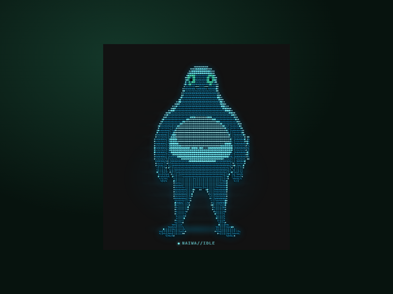
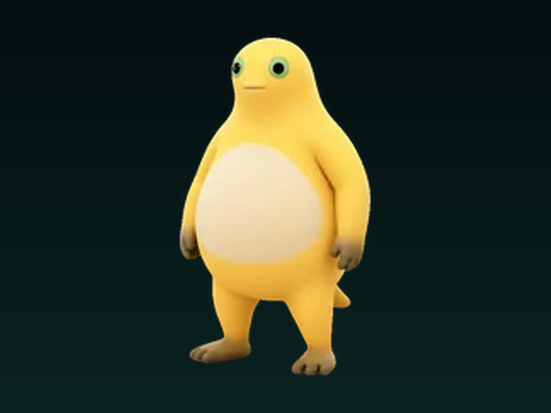

# Cyber Naiwa

> 赛博奶蛙 · Let Naiwa move into every Naiwa-family computer.

[](https://github.com/natricknye/CyberNaiw/actions/workflows/build.yml)

[简体中文](README.md) | **English**

Cyber Naiwa (赛博奶蛙) is a cross-platform desktop pet built around 奶蛙 (Naiwa), the gleefully unhinged yellow frog from Chinese internet memes. It has three forms: **Original Cyber** and **Quantum Cyber** use a pixel-mapped ASCII sprite (112×70 and 128×80), while **Naiwa Classic** uses the original artwork directly. The adult is tall and long-limbed; the baby is short, round, big-headed, with tiny limbs. Click it to trigger the laugh. Everything runs locally — no account, no cloud, no telemetry.

- A transparent, frameless, always-on-top pet window
- Left-drag to move; adult left-click cycles actions, right-click laughs
- Middle-click opens Settings; Ctrl/⌘ + right-click opens the native menu
- Actions and laughs play the matching Naiwa voice line, with a mute switch in Settings
- Adult actions: stand, horse stance, walk, run, look around, think, clap, eat, crouch
- Three forms: Original Cyber / Quantum Cyber (ASCII) and Naiwa Classic (original artwork)
- Adult and baby Naiwa, with warm Original or blue-black Quantum colourways
- Chinese app UI; English documentation in `README.en.md`
- Tray menu to show, hide, open settings, or quit
- Local JSON settings that survive a restart
- Fully offline; no database or sign-up
- Windows and macOS builds via GitHub Actions

## Download

| Platform | Installer | Notes |
| --- | --- | --- |
| Windows 10/11 x64 | [CyberNaiwa_0.2.2_x64-setup.exe](https://github.com/natricknye/CyberNaiw/releases/download/v0.2.2/CyberNaiwa_0.2.2_x64-setup.exe) | NSIS, installs for the current user; no admin required |
| macOS 11+ Apple Silicon | [CyberNaiwa_0.2.2_aarch64.dmg](https://github.com/natricknye/CyberNaiw/releases/download/v0.2.2/CyberNaiwa_0.2.2_aarch64.dmg) | Unsigned and not notarized; right-click → Open the first time |

[All releases](https://github.com/natricknye/CyberNaiw/releases) · [Build logs](https://github.com/natricknye/CyberNaiw/actions)

The installer uses the same baby Original Cyber ASCII art and Quantum blue-black palette:


> The current macOS build is **arm64 only**. Intel Mac support is still on the list. Neither build is code-signed yet: Windows SmartScreen may warn, and macOS needs the right-click → Open dance on first launch.

## Preview

| Original Cyber · 112×70 | Quantum Cyber · 128×80 |
| --- | --- |
|  |  |

Original Cyber and Quantum Cyber are coloured ASCII grids, not flat images: 112×70 and 128×80. `#` for the yellow body, `O` for the green eyes, `@` for the pupils, `+` for the cream belly, `|` for the olive-brown limbs, `_` for the mouth cavity, and `=` for the teeth. Closed-mouth frames keep the official reference's very short mouth line; no synthetic nose or hard chin line is drawn. Every cell has a matching solid backing so the character never lets the desktop show through, while everything outside the silhouette stays transparent. A soft CRT scanline pass sits on top, and the settings panel scales the whole sprite.

Naiwa Classic uses the original artwork with no ASCII conversion:



| Mode | Options |
| --- | --- |
| Growth stage | Adult (tall pear) / Baby (short, round, big-headed, tiny limbs) |
| Form | Original Cyber (warm yellow + cream + olive, 112×70) / Quantum Cyber (blue-black + cyan terminal, 128×80) / Naiwa Classic (original artwork, transparent background) |
| Actions | Adult: stand, horse stance, walk, run, look around, think, clap, eat, crouch; baby: idle, walk, happy, raise-hand — the two stacks are separate |

Baby preview:


> Quantum Cyber is the default. For the warm ASCII look: Settings → Form → Original Cyber. For the artwork: choose Naiwa Classic. The right-hand image above is Quantum Cyber.

## Settings


Always-on-top, size, adult/baby, the three forms, animation, the status label, and sound live in one panel; About opens on demand and takes no main-panel space. The console uses the Quantum Cyber blue-black terminal palette.

## Stack

| Layer | Tech |
| --- | --- |
| Desktop shell | Tauri 2 |
| Frontend | React 19 + TypeScript + Vite |
| Looks | CSS + 128×80/112×70 ASCII frames + classic artwork PNGs + SVG icon |
| Native bits | Rust (tray, window lifecycle, quit) |
| Settings | `tauri-plugin-store`, local JSON |
| Package manager | pnpm (Corepack works too) |
| CI | GitHub Actions (Windows + macOS) |

## Requirements

- Node.js 22 LTS or newer
- pnpm 10+ (the repo pins a version through `packageManager`)
- Rust stable via `rustup`
- Windows: Visual Studio 2022 C++ tools + Windows 10/11 SDK + WebView2 Runtime
- macOS: Xcode Command Line Tools (`xcode-select --install`)

If pnpm isn't installed yet, Corepack can help:

```bash
corepack enable
corepack pnpm install
```

## Development

```bash
pnpm install
pnpm tauri dev
```

Just want the browser preview? Tauri APIs are skipped there:

```bash
pnpm dev
# Pet:     http://localhost:1420/?window=pet
# Settings: http://localhost:1420/?window=settings
```

## Build

```bash
# Everything configured in tauri.conf.json
pnpm tauri build

# Windows NSIS installer only
pnpm tauri build --bundles nsis

# macOS DMG only
pnpm tauri build --bundles dmg
```

Outputs:

- Windows: `src-tauri/target/release/bundle/nsis/*.exe`
- macOS: `src-tauri/target/release/bundle/dmg/*.dmg`

## Where settings live

The official `tauri-plugin-store` writes `settings.json` to the app data directory:

- Windows: `%APPDATA%\com.cybernaiwa.desktop\settings.json`
- macOS: `~/Library/Application Support/com.cybernaiwa.desktop/settings.json`

Two keys live in that file: `settings` (always-on-top, scale, animation, sound, status label, adult/baby, Original Cyber / Quantum Cyber / Naiwa Classic) and `windowPosition` (physical pixels). Nothing is synced anywhere.

## Character art

The default `cyber-naiwa` skin stores Original Cyber adult/baby frames in `naiwa-frames.json` and `naiwa-baby-frames.json` (112×70), and Quantum Cyber adult/baby frames in `naiwa-cyber-frames.json` and `naiwa-cyber-baby-frames.json` (128×80). Each set covers five base poses; adult happy/click use 25 frames each, other base states use two, and the baby uses two per state. The extra adult actions (run/look/think/clap/eat/crouch) are registered in `index.ts` as aliases of the closest base pose, with their own HUD labels, timing and durations. `frames.ts` maps characters to colour tones and declares frame timing. The 25 adult laugh frames come from [liaosongjie/Codex-Voice-Input](https://github.com/liaosongjie/Codex-Voice-Input)'s MIT animation frames (fixed-crop conversion to ASCII); the other grids were pixel-mapped from the official design database's adult, juvenile, laugh, and wave references. No ASCII reference image files themselves are shipped in the repo. The app icon is taken from the baby's Original Cyber ASCII idle frame instead of being drawn separately.

The `naiwa-classic` skin lives in `src/assets/pets/classic/`: adult idle/wave and all three baby states are transparent cut-outs of the official design reference sheets; adult happy/click uses `classic/laugh-hd/000–024.webp`, extracted from the 1080×1474 `naiwa-laugh.mp4` at 6.5–8.75 s. The 25 frames have their white background and floor shadow removed, keep 3% padding, and are Lanczos-downscaled to 524×720 with no sharpening at 90 ms each. `classic/laugh/` keeps the original 180×180 MIT frames and `classic/laugh-hires/` keeps the 648×888 6× upscale fallback. The video source has no explicit redistribution licence in `SOURCES.md`; the project owner approved its fan-use inclusion, and the skin can switch back to `laugh-hires` if needed. Action frames use `classic/actions/<action>/` padded to 180×210 with a 6 px bottom margin. Images scale to the window height so the body stays about 280 px and the feet stay visible. The cut-out/upscale scripts are `_qa/make-classic-cutouts.ps1`, `_qa/crop-classic-laugh.ps1`, `_qa/upscale-classic-laugh.py`, `_qa/build-hd-laugh.py`, and `_qa/build-classic-actions.py` (`_qa/` is not committed). This is fan-made, non-commercial use; source and licence notes are in `_qa/reference/official/laugh/SOURCES.md`.

Want to try a PNG/WEBP/GIF skin? `src/assets/pets/README.md` shows how to register an `ImagePetSkin`. The renderer already handles both ASCII and image sequences. Please only add art you have the right to redistribute.

## Platforms and rough edges

- **Windows**: built and exercised on this machine. Transparency, the frameless window, native drag, tray, and settings persistence all work.
- **macOS**: transparent windows rely on `macOSPrivateApi`, which rules out the Mac App Store. The app hasn't been run on a Mac here; CI only proves it builds. Code signing and notarization are not configured yet.
- Only non-transparent character pixels trigger a click effect; transparent margins can still drag the window but never play a voice line or show a subtitle. The window itself still catches the mouse and does not click through to the desktop yet, which is a known v1 limitation.
- Closing the settings window only hides it. Use the tray menu or Ctrl/⌘ + right-click to quit.
- Click and drag share the pointer: the native drag starts only after 5px of movement, so a plain click never drags the pet away.
- With animation off, clicks still switch actions and trigger the laugh, but frames stay static and the horse stance no longer appears automatically.
- All three adult art forms share the same action stack. Naiwa Classic uses real frame sequences; Original/Quantum ASCII reuse the closest existing poses for the new actions (run = fast walk, crouch = horse stance, look/think = idle, clap/eat = laugh).

## Design notes

The character follows the official Naiwa design database and the [Naiwa wiki](https://neta.art/app/milk-frog-wiki): the adult is tall and long-limbed, the baby is short, round, big-headed, with tiny limbs; both have a pale cream belly, pale green eye rings with centred black pupils, and a tiny horizontal mouth. The adult action library comes from the `pet/` frame sequences in [Nailong-Studio/NaiWa-Wallpaper](https://github.com/Nailong-Studio/NaiWa-Wallpaper) (MIT): walk, run, look around, think, clap, eat, and crouch. The baby uses only the official juvenile reference poses and never borrows adult actions. Click-to-interact is the core: adult left-click advances the action stack, right-click laughs; it starts standing and only occasionally shifts into the horse stance on its own.

## Voice and audio sources

Each click line has a matching audio clip; all come from Chinese Naiwa memes, not lines written for this project:

| Line | File | Length |
| --- | --- | --- |
| 安迪 | `naiwa-andi.wav` | 1.85s |
| 嘎嘎提拉瞎 | `naiwa-gaga.wav` | 1.17s |
| 干巴得 | `naiwa-ganbade.wav` | 1.11s |
| 哈哈哈哈哈 | `naiwa-laugh-long.wav` | 4.11s |
| 哦啦 | `naiwa-ola.wav` | 0.96s |
| 噶韭菜 | `naiwa-gajiucai.wav` | 0.89s |

The six clips come from the `音效/` directory of [VIPmrgj/Dragon-frog](https://github.com/VIPmrgj/Dragon-frog). That repository declares no LICENSE. This project uses them as a non-commercial fan work and records the original file names and source in `src/assets/audio/README.md`; the rights remain with their creators, and the clips will be removed on request.

Interaction:

- **Adult start**: stands idle. Every 9–16 seconds it may briefly shift into the horse stance, then stand again.
- **Adult left-click**: advances one action: stand → horse stance → walk → run → look around → think → clap → eat → crouch → stand, and plays a random 安迪 / 嘎嘎提拉瞎 / 干巴得 / 哦啦 / 噶韭菜 line.
- **Adult right-click**: plays the laugh and the full laugh animation; it no longer opens the menu.
- **Adult middle-click**: opens Settings.
- **Adult Ctrl/⌘ + right-click**: opens the native menu (Settings / Hide / Quit).
- **Tray**: still shows/hides the pet, opens Settings, and quits.
- **Baby**: keeps a separate stack with no laugh clip; left-click plays one meme line and the happy reaction, right-click still opens the native menu.
- With sound off, the same line is shown as a subtitle instead.
- Every other adult action is click-only and never plays automatically.

Line research and the older 1.8 s MIT laugh:

- 《捧腹大笑思想与奶龙学概论》 chapter 6, “奶蛙的衍生语”: <https://xn--psszg58c9c2281ajit.lol/files/history.pdf>
- naiwa.meme sticker archive: <https://naiwa.meme/stickers>
- Milk Frog Keyboard's 13-sound list: <https://mwm.ai/it/apps/milk-frog-music-meme-beats/6762385358>
- [Nailong-Studio/NaiWa-Wallpaper](https://github.com/Nailong-Studio/NaiWa-Wallpaper) `audio/奶蛙-桌宠笑声.wav` (MIT, 1.8 s, kept as the unused `naiwa-laugh.wav` fallback)

“卡球赛” is most likely a mishearing of “卡脚先” or 《喀秋莎》; no independently licensed “卡球赛” recording was found, so it is not bundled.

## License and disclaimer

MIT — see [LICENSE](LICENSE).

CyberNaiwa is a fan-made, non-commercial open-source project inspired by the Chinese internet meme 奶蛙 (Naiwa). 奶龙 (Nailong) is the cute, copyrighted original; 奶蛙 is the uncanny AI/community derivative, and this project uses only 奶蛙. The ASCII frames in this repo were converted and drawn by this project from public references. Naiwa Classic ships cut-outs made from public design references, the adult action frames come from Nailong-Studio/NaiWa-Wallpaper (MIT), and the high-resolution laugh frames come from `naiwa-laugh.mp4` (no explicit redistribution licence; approved by the project owner for fan use). The lower-resolution fallback laugh comes from Codex Voice Input's MIT animation. Those image assets remain the property of their original creators and are used for this non-commercial fan project; they will be removed on request. The six click voice clips come from the public asset repository above and remain the property of their original creators.

## Build status

The GitHub Actions workflow at `.github/workflows/build.yml` builds an NSIS installer and a DMG on Windows and macOS runners. v0.2.2 (128×80 Quantum / 112×70 Original, five states, six click voice clips, baby ASCII icon, blue-black terminal console) is published under [Releases](https://github.com/natricknye/CyberNaiw/releases/tag/v0.2.2). Builds are unsigned until signing/notarization secrets are configured.
