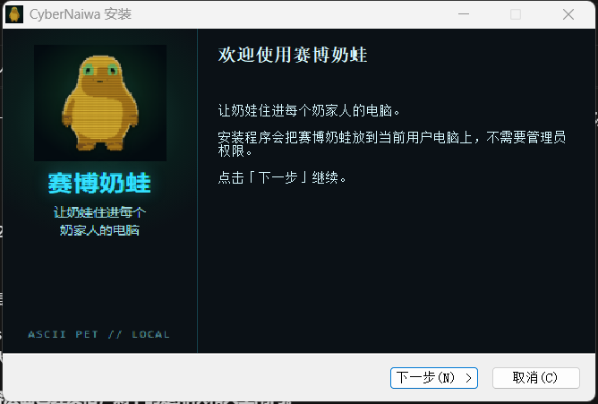
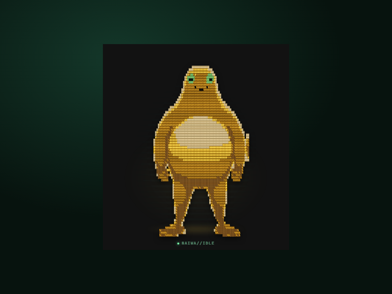
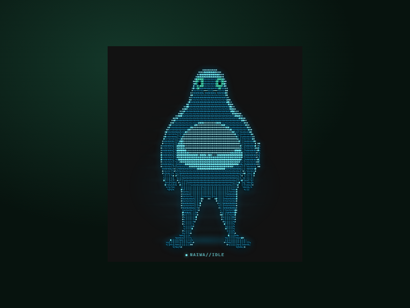
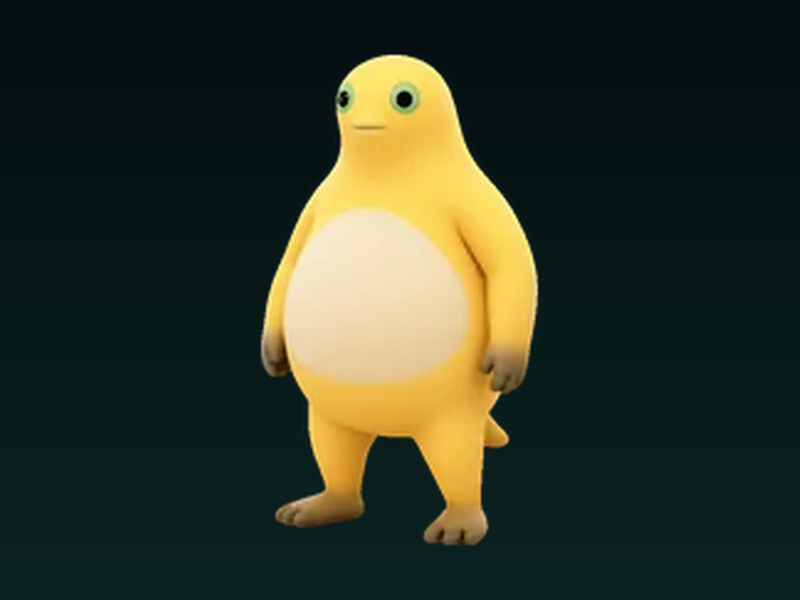
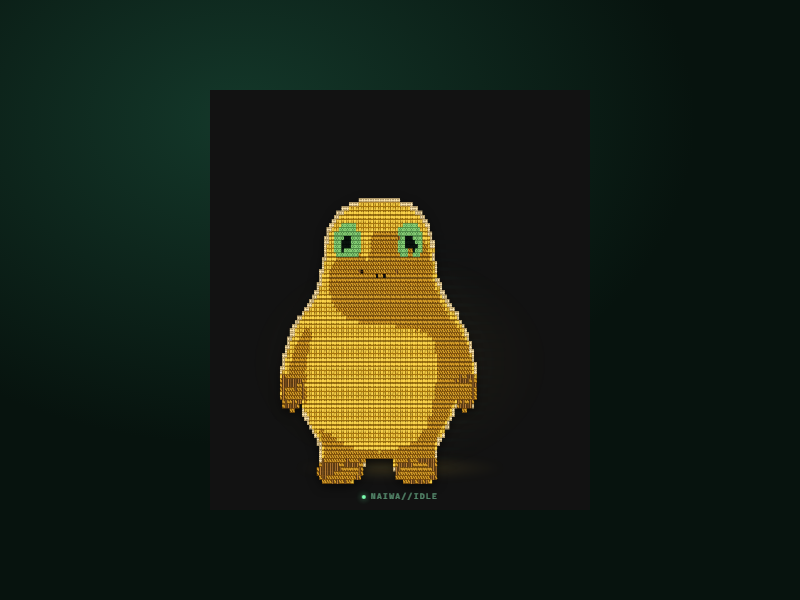
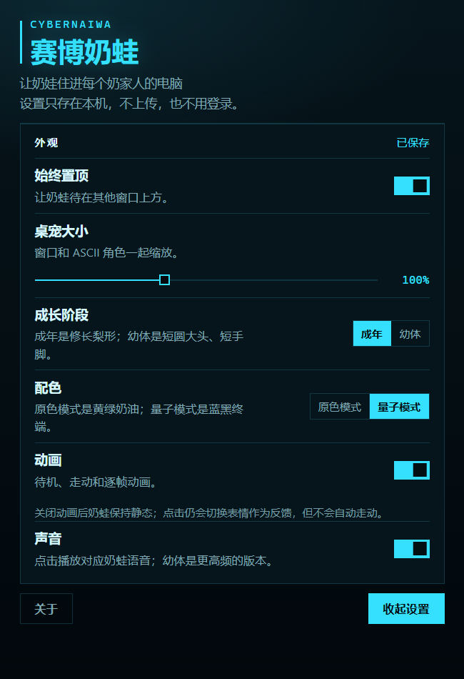

# 赛博奶蛙

> 让奶娃住进每个奶家人的电脑。

[](https://github.com/natricknye/CyberNaiw/actions/workflows/build.yml)

**简体中文** | [English](README.en.md)

赛博奶蛙是一只住在你桌面上的奶蛙。它有三种形态：**原色赛博**和**量子赛博**用彩色 ASCII 像素网格（112×70 / 128×80），**奶家经典**直接使用原画。成年是长腿瘦高版，幼体是短圆大头、短手脚；暖黄色身体、浅奶油色大肚皮、浅绿眼环和居中黑瞳，还有一条极短的水平嘴线——点一下就会笑。所有东西都在本地运行，不联网、不注册、不收集数据。

- 透明、无边框、始终置顶的桌宠窗口
- 左键拖动；成年左键切换动作，右键大笑；中键打开设置
- Ctrl/⌘ + 右键打开原生菜单（设置 / 隐藏 / 退出）
- 切换动作或大笑时播放对应奶蛙语音，设置里可以静音
- 成年动作：站立、扎马步、走、跑、张望、思考、鼓掌、蹲伏
- 三种形态：原色赛博 / 量子赛博（ASCII）、奶家经典（原画）
- 成年奶蛙 / 幼体奶蛙，原色赛博暖黄 / 量子赛博蓝黑两套配色
- 应用界面中文；英文说明保留在 `README.en.md`
- 系统托盘显示/隐藏、打开设置、退出
- 设置本地 JSON 持久化，重启后恢复
- 不联网、不注册、无数据库、无遥测
- Windows 与 macOS；GitHub Actions 自动构建

## 下载

| 平台 | 安装包 | 说明 |
| --- | --- | --- |
| Windows 10/11 x64 | [CyberNaiwa_0.2.2_x64-setup.exe](https://github.com/natricknye/CyberNaiw/releases/download/v0.2.2/CyberNaiwa_0.2.2_x64-setup.exe) | NSIS，当前用户安装，不要求管理员 |
| macOS 11+ Apple Silicon | [CyberNaiwa_0.2.2_aarch64.dmg](https://github.com/natricknye/CyberNaiw/releases/download/v0.2.2/CyberNaiwa_0.2.2_aarch64.dmg) | 未签名/未公证；首次打开需右键 → 打开 |

[所有版本](https://github.com/natricknye/CyberNaiw/releases) · [构建日志](https://github.com/natricknye/CyberNaiw/actions)

安装器也使用幼体原色 ASCII 主题，欢迎页和完成页都是量子蓝黑配色：



> 当前 macOS 包是 **arm64**，Intel Mac 版本待补。Windows/macOS 均未签名：Windows SmartScreen 可能提示，macOS 首次打开请右键选择“打开”。

## 预览

| 原色赛博 · 112×70 | 量子赛博 · 128×80 |
| --- | --- |
|  |  |

原色赛博 / 量子赛博不是图片贴图，而是彩色 ASCII 字符网格：原色赛博 112×70、量子赛博 128×80。`#` 黄身体、`O` 绿眼、`@` 瞳孔、`+` 奶油肚皮、`|` 橄榄褐手脚、`_` 嘴腔、`=` 牙齿、`*`/`!` 动作高亮；闭嘴帧保留官方源图里的极短嘴线，不额外画鼻/下巴硬线。每个字符背后铺同色实体底，角色内部不会透出桌面，角色外仍然是透明窗口；再叠加 CRT 扫描线，设置里可以缩放。

奶家经典使用原画，不再转成 ASCII：



| 模式 | 选项 |
| --- | --- |
| 成长阶段 | 成年（修长梨形）/ 幼体（短圆大头、短手脚） |
| 形态 | 原色赛博（暖黄 + 奶油 + 橄榄褐，112×70）/ 量子赛博（蓝黑 + 青色终端，128×80）/ 奶家经典（原画，透明背景） |
| 动作 | 成年：站立、扎马步、走、跑、张望、思考、鼓掌、蹲伏；幼体：待机、走、开心、抬手，动作栈与成年分开 |

幼体单独预览：



> 默认是「量子赛博」。想看暖黄 ASCII：打开设置 →「形态」→ 点「原色赛博」；想看原画：点「奶家经典」。上面右图是量子赛博效果。

## 设置页



透明置顶、桌宠大小、成年/幼体、三种形态、动画开关和声音开关都在同一个面板里；「关于」按需打开，不占主面板空间。控制台使用量子赛博的蓝黑终端配色。桌宠下方的 `NAIWA//IDLE` 不再提供开关：原色赛博用暖黄、量子赛博用蓝色 HUD，奶家经典不显示 HUD。

## 技术栈

| 层 | 技术 |
| --- | --- |
| 桌面框架 | Tauri 2 |
| 前端 | React 19 + TypeScript + Vite |
| 样式/角色 | CSS + 128×80/112×70 ASCII 帧 + 经典原画 PNG + SVG 图标 |
| 原生层 | Rust（托盘、窗口生命周期、退出） |
| 设置 | `tauri-plugin-store` 本地 JSON |
| 包管理 | pnpm（Corepack 可用） |
| CI | GitHub Actions（Windows + macOS） |

## 环境要求

- Node.js 22 LTS 或更新版本
- pnpm 10+（仓库用 `packageManager` 固定版本）
- Rust stable（`rustup`）
- Windows：Visual Studio 2022 C++ 工具链 + Windows 10/11 SDK + WebView2 Runtime
- macOS：Xcode Command Line Tools（`xcode-select --install`）

本机没有 pnpm 时可以用 Corepack：

```bash
corepack enable
corepack pnpm install
```

## 开发

```bash
pnpm install
pnpm tauri dev
```

只启动前端预览（浏览器里不会调用 Tauri API）：

```bash
pnpm dev
# 桌宠页面：http://localhost:1420/?window=pet
# 设置页面：http://localhost:1420/?window=settings
```

## 构建

```bash
# 当前平台，Tauri 配置里的全部 bundle 目标
pnpm tauri build

# 只出 Windows NSIS 安装包
pnpm tauri build --bundles nsis

# 只出 macOS DMG
pnpm tauri build --bundles dmg
```

产物位置：

- Windows：`src-tauri/target/release/bundle/nsis/*.exe`
- macOS：`src-tauri/target/release/bundle/dmg/*.dmg`

## 设置存储

设置通过官方 `tauri-plugin-store` 写入应用数据目录的 `settings.json`：

- Windows：`%APPDATA%\com.cybernaiwa.desktop\settings.json`
- macOS：`~/Library/Application Support/com.cybernaiwa.desktop/settings.json`

文件里有两个键：`settings`（置顶、缩放、动画、声音、成年/幼体、原色赛博/量子赛博/奶家经典）和 `windowPosition`（物理像素坐标）。没有云端同步。

## 角色素材

默认 ASCII 角色 `cyber-naiwa` 的原色赛博成年帧在 `src/assets/pets/cyber-naiwa/naiwa-frames.json`，幼体帧在 `naiwa-baby-frames.json`（112×70）；量子赛博成年/幼体帧在 `naiwa-cyber-frames.json`、`naiwa-cyber-baby-frames.json`（128×80）。现有帧覆盖 idle / walk / happy / click / wave；成年 happy/click 各 25 帧，其余状态每态 2 帧；幼体每态 2 帧。新增的 run / look / think / clap / eat / crouch 在 `src/assets/pets/index.ts` 复用最接近的现有 ASCII 姿态，但保留独立 HUD 标签、帧间隔和动作时长。字符 tone、帧间隔和渲染逻辑在 `frames.ts`。成年大笑的 25 帧来自 [liaosongjie/Codex-Voice-Input](https://github.com/liaosongjie/Codex-Voice-Input) 的 MIT 动画帧（固定取景后转成 ASCII）；其余帧由官方设计资料库中的成年 / 幼体 / 大笑 / 挥手参考图逐像素映射生成，ASCII 帧的参考图片本身不入库。应用图标取自幼体原色赛博 ASCII 待机帧，不再单独绘制。

奶家经典皮肤 `naiwa-classic` 在 `src/assets/pets/classic/`：成年待机默认使用**正面** `adult-idle-aligned.png`（官方正面站立，×1.14 亮度、×0.78 色彩，向动作帧的明度/饱和度对齐），脚和腿完整落在窗口内。Nailong 的 `classic/idle/00–05.png` 是 3/4 侧身待机备选，画面会斜着站，所以不作为默认站立。成年挥手和幼体三态是官方设计参考图的透明抠图；幼体三态已重新放宽裁切，手、脚、膝盖都有 14px 内边距；成年 happy/click 使用 `classic/laugh-hd/000–024.webp`，从 1080×1474 的 `naiwa-laugh.mp4` 6.5–8.75 秒抽 25 帧，去掉白底、地面阴影和胯下白块，统一留 3% 边距后 Lanczos 缩到 524×720，不做锐化，164ms/帧，和 4.11 秒大笑音频对齐。`classic/laugh/` 保留原始 180×180 MIT 帧，`classic/laugh-hires/` 保留 648×888 的 6× 放大回退版；视频源的再分发许可记录不完整，已按项目所有者确认作为粉丝二创使用，必要时可切回 `laugh-hires`。走、跑、张望、思考、鼓掌、蹲伏使用 `classic/actions/<action>/` 的逐帧原画，来自 Nailong-Studio 的 MIT 素材，统一补齐到 180×210 画布、底部留 6px，所以脚和膝盖不会被窗口裁掉；`进食` 帧保留在素材里，但因为张嘴仰头太像大笑，暂不接入左键动作栈。图片按窗口高度缩放，成年待机和动作的身体高度约 280px。抠图/放大/补帧脚本是 `_qa/make-classic-cutouts.ps1`、`_qa/make-baby-cutouts.py`、`_qa/crop-classic-laugh.ps1`、`_qa/upscale-classic-laugh.py`、`_qa/build-hd-laugh.py`、`_qa/build-classic-actions.py` 和 `_qa/build-classic-idle.py`（`_qa/` 不入库）。这部分是粉丝二创非商业使用，来源与授权说明见 `_qa/reference/official/laugh/SOURCES.md`。

想换成 PNG/WEBP/GIF 皮肤时，按 `src/assets/pets/README.md` 的说明注册 `ImagePetSkin` 即可，渲染器同时支持 ASCII 和图片序列。请不要提交没有 redistribution 权限的素材。

## 设计参考

角色设定参考奶蛙官方设计资料库与 [奶蛙百科](https://neta.art/app/milk-frog-wiki)：成年是长腿瘦高版，幼体是短圆大头、短手脚；浅奶油色大肚皮、浅绿眼环和居中黑瞳、极短水平嘴线。成年动作库来自 [Nailong-Studio/NaiWa-Wallpaper](https://github.com/Nailong-Studio/NaiWa-Wallpaper) 的 `pet/` 逐帧（MIT）：走、跑、张望、思考、鼓掌、进食、蹲伏；幼体只使用官方幼体三视图里的待机 / V 字手 / 叉腰，不与成年共用动作。点击互动是核心：成年左键走动作栈、右键大笑；初始站立，空闲时只偶尔自动扎马步。

## 台词与声音来源

点击台词和音频一一对应，全部来自中文互联网的奶蛙衍生语，不是本项目自编的台词：

| 台词 | 文件 | 时长 |
| --- | --- | --- |
| 安迪 | `naiwa-andi.wav` | 1.85s |
| 嘎嘎提拉瞎 | `naiwa-gaga.wav` | 1.17s |
| 干巴得 | `naiwa-ganbade.wav` | 1.11s |
| 哈哈哈哈哈 | `naiwa-laugh-long.wav` | 4.11s |
| 哦啦 | `naiwa-ola.wav` | 0.96s |
| 噶韭菜 | `naiwa-gajiucai.wav` | 0.89s |

六段语音取自 [VIPmrgj/Dragon-frog](https://github.com/VIPmrgj/Dragon-frog) 的 `音效/` 目录。该仓库没有声明 LICENSE；本项目按粉丝二创、非商业方式使用，并在 `src/assets/audio/README.md` 标注原始文件名与来源。奶蛙形象和语音的权利归各自原作者/二创作者，若权利人要求会立即移除。

交互规则：

- **成年初始**：站立待机；空闲 9–16 秒会偶尔自动切到扎马步，然后回到站立。
- **成年左键**：按动作栈前进一档：站立 → 扎马步 → 走 → 跑 → 张望 → 思考 → 鼓掌 → 蹲伏 → 站立，并随机播一条安迪 / 嘎嘎提拉瞎 / 干巴得 / 哦啦 / 噶韭菜。点进一个动作流程后，必须等动作和语音都完全结束，下一次点击才会进入下一档；流程中的点击会被忽略。
- **成年右键**：播「哈哈哈哈哈」并完整播放大笑，不再弹出菜单。**大笑只属于右键**，左键动作栈不含 `happy`/`click`，也不会召唤出像大笑的“进食”张嘴仰头姿势。
- **右上角齿轮**：只有鼠标悬停在桌宠窗口上时，右上角才显示半透明齿轮；点它打开设置。移开鼠标后齿轮隐藏。
- **成年中键**：按下鼠标滚轮打开设置（笔记本触控板没有中键时用齿轮或托盘）。
- **成年 Ctrl/⌘ + 右键**：打开原生菜单（设置 / 隐藏 / 退出）。
- **托盘**：仍然可以显示/隐藏桌宠、打开设置、退出。
- **幼体**：没有大笑语音，动作栈与成年分开；左键只播安迪类台词并开心，右键仍是原生菜单。
- 静音时不播音频，改成显示同一句字幕。
- 其他成年动作只能通过左键点击到达，不会随机自动播放。原色/量子赛博的鼓掌复用扎马步帧，刻意不复用大笑帧；“进食”帧保留在素材里，但不接入左键动作栈。

台词考据与旧版 1.8 秒 MIT 笑声来源：

- 《捧腹大笑思想与奶龙学概论》第六章「奶蛙的衍生语」：<https://xn--psszg58c9c2281ajit.lol/files/history.pdf>
- naiwa.meme 奶蛙表情包档案：<https://naiwa.meme/stickers>
- Milk Frog Keyboard 的 13 个奶蛙音效列表：<https://mwm.ai/it/apps/milk-frog-music-meme-beats/6762385358>
- [Nailong-Studio/NaiWa-Wallpaper](https://github.com/Nailong-Studio/NaiWa-Wallpaper) 的 `audio/奶蛙-桌宠笑声.wav`（MIT，1.8 秒，仓库内保留为 `naiwa-laugh.wav` 备用）

“卡球赛”目前更可能是“卡脚先”或《喀秋莎》的空耳；没有找到可确认授权的独立“卡球赛”原声，因此没有把它单独打包。

## 平台说明与已知限制

- **Windows**：本机已实际启动和构建验证。透明窗口、无边框、拖动、托盘、设置持久化均按 Windows 路径实现。
- **macOS**：透明窗口依赖 `macOSPrivateApi`，这会限制 Mac App Store 上架；本机无法验证 macOS 运行时，CI 只负责构建 DMG。代码签名与公证尚未配置，正式分发前需要 Apple Developer 证书和 `notarytool`。
- 只有点到角色的非透明像素才会触发点击效果；透明边缘只用于拖动窗口，不会触发语音/字幕。窗口整体仍会接收鼠标，暂时不能点击穿透到下层，这是 v1 的已知限制。
- 关闭设置窗口只是隐藏，退出应用请使用托盘或 Ctrl/⌘ + 右键菜单。
- 左键点击和拖动共用指针：移动超过 5px 才开始拖窗，纯点击不会拖走桌宠。
- 动画关闭后仍可点击切换动作和大笑，但动作帧保持静态，也不自动切扎马步。
- 成年三种美术形式共用同一套动作栈；奶家经典使用逐帧原画，原色/量子赛博的新动作暂时复用最接近的现有 ASCII 姿态（跑=快走、蹲伏=扎马步、张望/思考=待机、鼓掌/进食=笑）。

## 开源与免责声明

MIT License，见 [LICENSE](LICENSE)。

CyberNaiwa 是粉丝向、非商业的开源项目，灵感来自中文互联网迷因「奶蛙」。奶龙是可爱的原版、有版权；奶蛙是猎奇向的 AI/网友二创，本项目只做奶蛙，与奶龙官方及其权利方无关联。仓库内的 ASCII 角色帧由本项目基于公开参考图转换和绘制；奶家经典的原画抠图来自公开的设计参考图，成年动作逐帧来自 Nailong-Studio/NaiWa-Wallpaper（MIT）；高清大笑帧来自 `naiwa-laugh.mp4`（再分发许可记录不完整，经项目所有者确认按粉丝二创使用），低分辨率回退帧来自 Codex Voice Input 的 MIT 动画。这些图片素材的权利归各自原作者/二创作者，若权利人要求会移除。六段点击语音同样来自上述公开素材仓库。

## 构建状态

GitHub Actions 工作流在 `.github/workflows/build.yml`，在 Windows 和 macOS Runner 上分别构建 NSIS 安装包和 DMG。v0.2.2（量子模式 128×80 / 原色模式 112×70、五态、六段点击语音、幼体 ASCII 图标、蓝黑终端控制台）发布到 [Releases](https://github.com/natricknye/CyberNaiw/releases/tag/v0.2.2)。签名/公证 secrets 未配置，因此产物为未签名版本。
